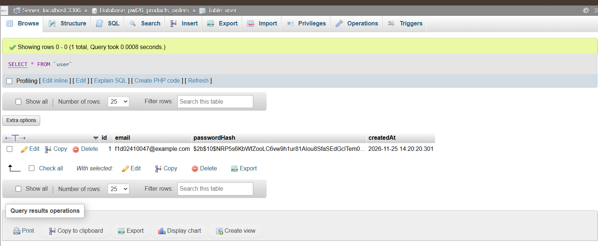
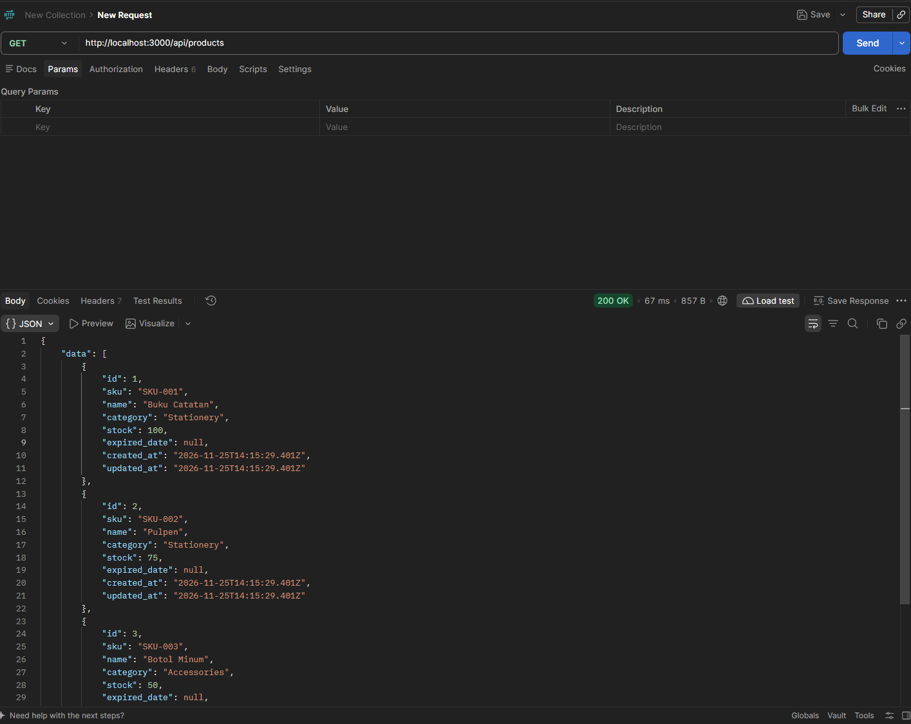
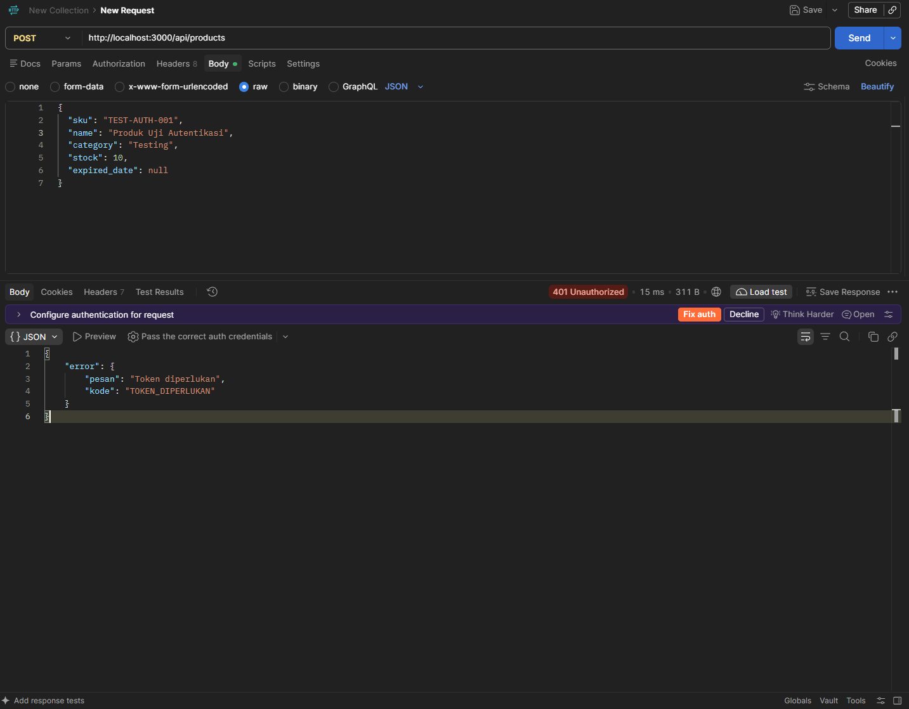
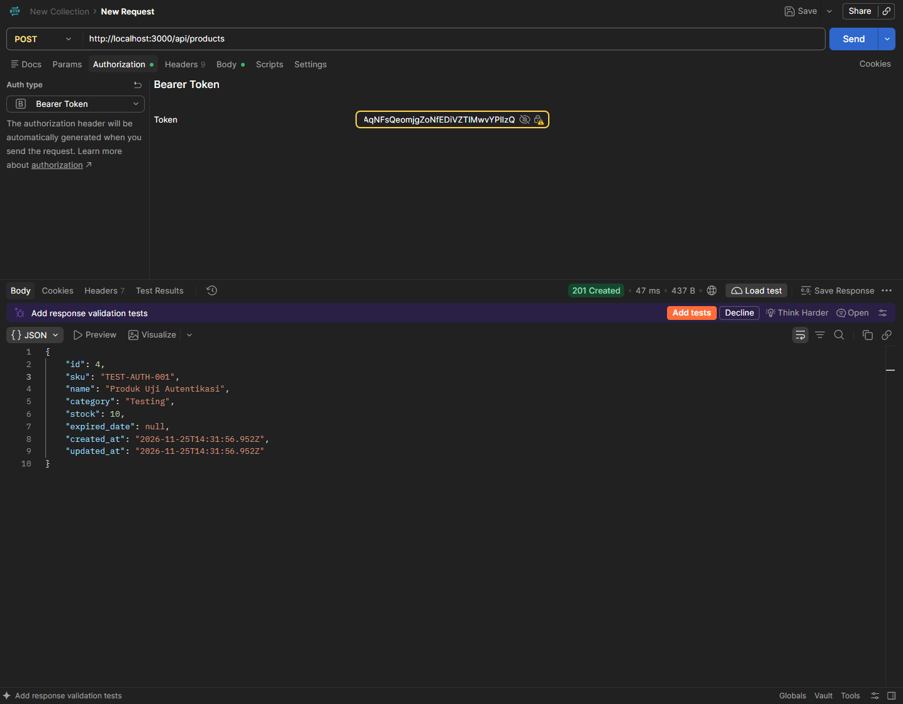
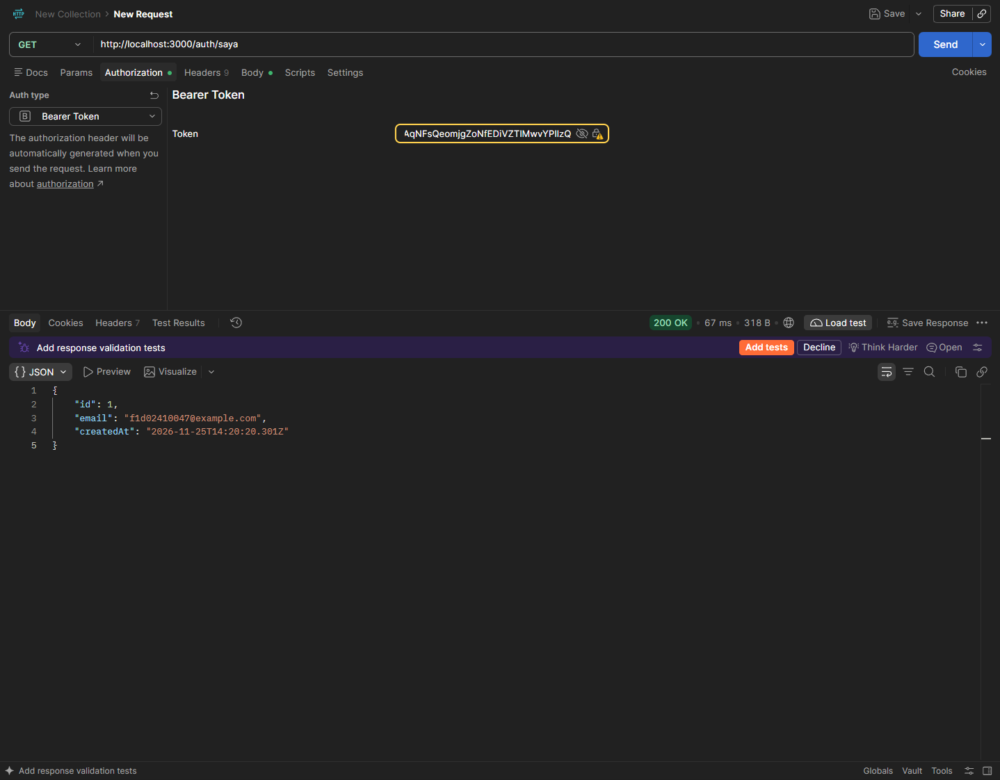
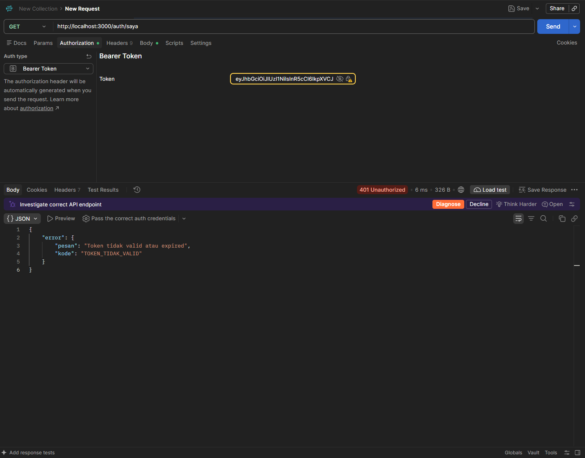
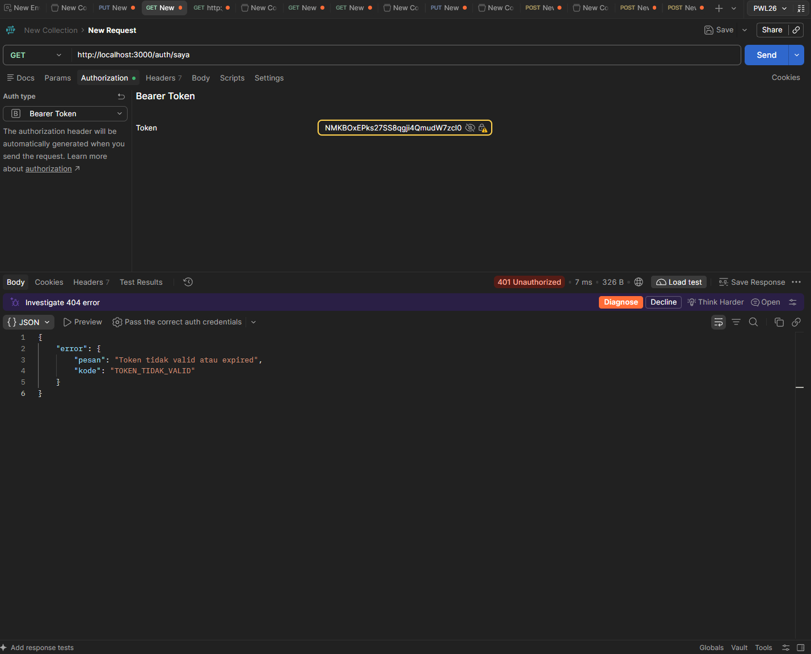
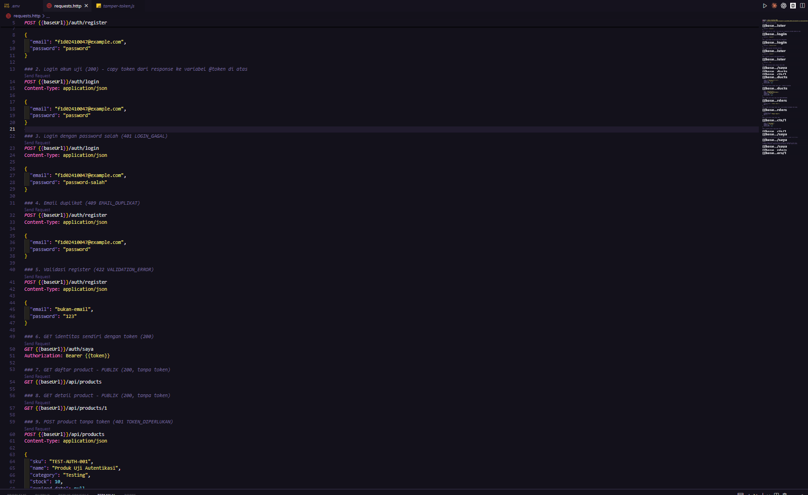

# Tugas 9 - Autentikasi & Otorisasi

Tugas ini merupakan pengembangan dari mini project ETS **Products & Orders REST API**. Pada versi ini ditambahkan fitur register, login, penggunaan JWT, dan pembatasan akses untuk endpoint tertentu. Struktur project ETS tetap digunakan, dengan beberapa penyesuaian supaya fitur autentikasi bisa berjalan.

## Identitas

- Nama: **FAUZAN HARI RAMDANI**
- NIM: **F1D02410047**
- Project ETS: Products & Orders REST API

## Teknologi yang digunakan

- Node.js, Express, dan TypeScript
- Prisma ORM dan MySQL
- Joi untuk validasi input
- bcrypt untuk hash password
- JWT untuk token login (masa berlaku 2 jam)

## Fitur yang ditambahkan

- Register melalui `POST /auth/register`. Password disimpan dalam bentuk hash bcrypt, bukan password asli.
- Login melalui `POST /auth/login` untuk mendapatkan token.
- `GET /auth/saya` untuk mengecek identitas user yang sedang login.
- Middleware `butuhLogin` untuk memeriksa token sebelum mengakses endpoint yang dibatasi.
- Penanganan error dengan format response yang seragam.

## Endpoint

| Method | Endpoint            | Akses       |
| ------ | ------------------- | ----------- |
| GET    | `/`                 | Publik      |
| POST   | `/auth/register`    | Publik      |
| POST   | `/auth/login`       | Publik      |
| GET    | `/auth/saya`        | Harus login |
| GET    | `/api/products`     | Publik      |
| GET    | `/api/products/:id` | Publik      |
| POST   | `/api/products`     | Harus login |
| PUT    | `/api/products/:id` | Harus login |
| DELETE | `/api/products/:id` | Harus login |
| GET    | `/api/orders`       | Publik      |
| GET    | `/api/orders/:id`   | Publik      |
| POST   | `/api/orders`       | Harus login |

## Persiapan dan cara menjalankan

### 1. Siapkan database

Pastikan Node.js sudah terpasang dan MySQL berjalan, misalnya lewat XAMPP atau Laragon. Buat database bernama `pwl26_products_orders`:

```sql
CREATE DATABASE pwl26_products_orders;
```

### 2. Atur file `.env`

Salin `.env.example`, lalu ubah namanya menjadi `.env`. Sesuaikan username dan password MySQL dengan konfigurasi di komputer masing-masing.

Contoh jika MySQL lokal menggunakan user `root` tanpa password:

```env
DATABASE_URL="mysql://root:@localhost:3306/pwl26_products_orders"
JWT_SECRET="SECRET_RANDOM_ANDA"
PORT=3000
```

Untuk membuat secret JWT acak, jalankan perintah ini di terminal:

```bash
node -p "require('node:crypto').randomBytes(32).toString('hex')"
```

Masukkan hasilnya ke `JWT_SECRET`. File `.env` jangan ikut di-upload ke repository.

### 3. Install package

Buka folder project di VS Code, pastikan terminal berada di folder yang memiliki `package.json`, kemudian jalankan:

```bash
npm install
```

### 4. Generate Prisma Client dan migrasi database

```bash
npx prisma generate
npx prisma migrate deploy
```

Migrasi ini membuat tabel dari project ETS dan menambahkan tabel `User`. Kalau database ETS lama sudah pernah dipakai, cek status migrasi terlebih dahulu dengan `npx prisma migrate status`. Sebaiknya gunakan database baru jika belum yakin dengan kondisi migration history.

### 5. (Opsional) Tambahkan data produk contoh

```bash
npm run seed
```

Seed akan menghapus data Order dan Product lalu membuat data contoh. Jangan jalankan jika database berisi data penting.

### 6. Jalankan server

```bash
npm run dev
```

Jika berhasil, server berjalan di `http://localhost:3000`. Coba buka alamat tersebut di browser untuk memastikan server aktif.

## Testing API

Pengujian dilakukan menggunakan file `requests.http` di VS Code dengan extension **REST Client** (Huachao Mao).

1. Buka `requests.http`.
2. Pastikan server sudah berjalan.
3. Klik **Send Request** pada request yang ingin dicoba.
4. Jalankan register, lalu login.
5. Salin token dari response login dan tempelkan ke variabel `@token` di bagian atas file, tanpa tanda kutip tambahan.
6. Coba request yang membutuhkan token.

Akun contoh untuk pengujian:

- Email: `f1d02410047@example.com`
- Password: `password`

Kalau email tersebut sudah terdaftar, gunakan email lain atau langsung lakukan login.

## Pengujian yang dilakukan

| Pengujian                           | Hasil yang diharapkan                                 |
| ----------------------------------- | ----------------------------------------------------- |
| Register user                       | Berhasil dan response tidak menampilkan password/hash |
| Login                               | Berhasil mendapatkan JWT                              |
| Login dengan password salah         | `401 LOGIN_GAGAL`                                     |
| Register email yang sudah digunakan | `409 EMAIL_DUPLIKAT`                                  |
| Input tidak sesuai validasi         | `422 VALIDATION_ERROR`                                |
| `GET /auth/saya` menggunakan token  | Berhasil menampilkan data user                        |
| GET products tanpa token            | Tetap bisa diakses                                    |
| POST product tanpa token            | `401 TOKEN_DIPERLUKAN`                                |
| POST product dengan token           | Berhasil jika data valid                              |
| POST order tanpa token              | `401 TOKEN_DIPERLUKAN`                                |
| POST order dengan token             | Berhasil jika produk dan stok sesuai                  |
| Token dimanipulasi                  | `401 TOKEN_TIDAK_VALID`                               |
| Token expired                       | `401 TOKEN_TIDAK_VALID`                               |

## Pengujian token

### Token dimanipulasi

1. Login dan salin token yang didapat.
2. Jalankan helper berikut di terminal, ganti `TOKEN_ASLI` dengan token milikmu:

```bash
node scripts/tamper-token.js "TOKEN_ASLI"
```

3. Salin token hasilnya, lalu gunakan untuk request yang membutuhkan login.
4. Server seharusnya menolak token tersebut dengan status `401`.

Helper mengubah payload token, tetapi signature tidak ikut diperbarui. Karena itu token tidak lagi valid.

### Token expired

1. Buka `src/services/authService.ts`.
2. Sementara ubah masa berlaku token dari `"2h"` menjadi `"5s"`.
3. Login ulang untuk mendapatkan token baru.
4. Tunggu sekitar 6–7 detik, lalu akses `GET /auth/saya`.
5. Token seharusnya ditolak dengan status `401`.
6. Setelah pengujian, **kembalikan masa berlaku token ke `"2h"`**.

## Bukti pengujian

Screenshot di bawah ini merupakan bukti pengujian yang saya lakukan. File gambarnya disimpan di folder `screenshot_t9`, jadi saat repository dibuka di GitHub, gambar akan tampil langsung di README selama folder dan nama file ini ikut di-push.

### 1. Register dan password hash

Menunjukkan proses register serta pengecekan bahwa password disimpan dalam bentuk hash, bukan teks asli.



### 2. Endpoint publik

GET endpoint dapat diakses tanpa mengirim token.



### 3. POST tanpa token

Request ke endpoint yang dilindungi ditolak ketika tidak menyertakan token.



### 4. POST menggunakan token

Request yang sama dapat dilakukan setelah login dan mengirim token JWT yang valid.



### 5. Pengujian user

Mengecek endpoint untuk mendapatkan informasi user yang sedang login.



### 6. Token dimanipulasi

Token yang payload-nya diubah tanpa memperbarui signature ditolak oleh server.



### 7. Token expired

Token yang sudah melewati masa berlaku tidak dapat digunakan lagi.



### 8. Request testing

File request yang digunakan untuk mencoba endpoint API melalui VS Code REST Client.



## Sedikit catatan tentang penggunaan AI

AI digunakan sebagai alat bantu saat memahami struktur project ETS, mencari referensi implementasi autentikasi, dan menyusun beberapa bagian dokumentasi serta skenario pengujian. Penyesuaian project, menjalankan aplikasi, mencoba endpoint, dan memeriksa hasil saya lakukan sebagai bagian dari proses pengerjaan tugas.

## Kesimpulan

Dari pengujian, fitur autentikasi ditambahkan ke REST API Products & Orders. Password user disimpan dalam bentuk hash bcrypt, login menghasilkan JWT, dan endpoint yang dibatasi hanya bisa diakses dengan token yang valid. Token yang dimanipulasi maupun sudah melewati masa berlaku ditolak oleh server.

## File yang berkaitan dengan tugas

- `requests.http`: kumpulan request untuk pengujian API.
- `scripts/tamper-token.js`: script untuk membuat token manipulasi sebagai bahan pengujian.
- `screenshot_t9/`: folder bukti screenshot pengujian.
- `prisma/migrations/`: migrasi database, termasuk penambahan tabel User.
